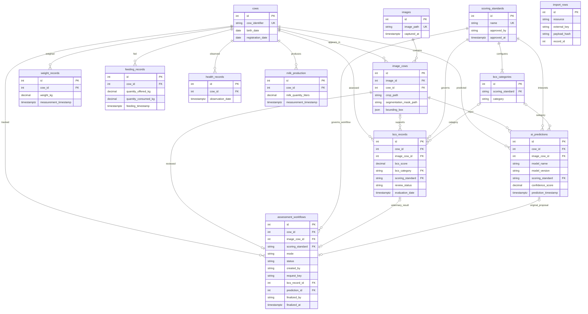

# CowScore entity relationships

`import_rows` is a transactional ingestion receipt with a logical resource-specific record reference. Composite ownership/category foreign keys are described in DATABASE_SCHEMA.md; the diagram abbreviates those pairs.
